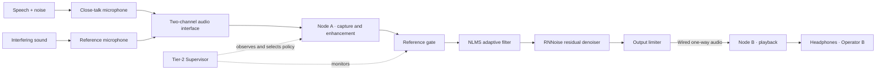

# TRISHUL VANI

### Adaptive speech enhancement for difficult noise environments

**VoltEdge · Smart India Hackathon 2026 · Problem Statement SIH26052 · DRDO · Hardware category**

TRISHUL VANI is a proposed cloud-free audio system that aims to reduce stationary, changing, and impulsive noise while preserving speech intelligibility on embedded hardware. The design combines two-channel microphone capture, adaptive digital signal processing, a streaming neural denoiser, and a supervisory control layer.

> **Prototype status:** This repository describes a system under development. The performance figures below are targets, not measured results. The project is not certified, field-ready, or intended to replace operational communications equipment.

## Interactive hardware model

Open the [3D bench model](TrishulVani-3D-Model.html) in a modern browser. It provides a walkthrough of the capture, processing, transport, and listening portions of the proposed setup. Use the step buttons or previous/next arrows to move through the model; drag to orbit and use the wheel or pinch gesture to zoom.

The model is a schematic illustration. It does not validate exact dimensions, component compatibility, wiring, DSP behavior, measured latency, or operational performance. It loads Three.js and OrbitControls from jsDelivr, so an internet connection is needed to render the scene.

## System overview

The demonstration is one-way. Operator A speaks into a close-talk microphone while a separate reference microphone captures the interfering sound. The synchronized channels enter Node A, where the enhancement pipeline runs. A wired connection carries the processed stream to Node B for playback through headphones to Operator B.

### Node A processing path

1. **Synchronous capture and input preparation** — acquire the two microphone channels together; remove DC offset, inspect clipping, and align framing.
2. **Reference gate** — determine whether the reference microphone is currently useful. If it is unreliable, avoid feeding poor reference data into the adaptive filter.
3. **NLMS adaptive cancellation** — estimate the part of the primary-channel noise correlated with the reference channel and subtract the estimate from the speech channel.
4. **RNNoise enhancement** — reduce residual noise that remains after adaptive cancellation.
5. **Output limiter** — constrain abrupt output peaks. A limiter controls level; it does not remove the underlying impulse.
6. **Tier-2 Supervisor** — monitor signal and device conditions, select a processing policy, and log mode changes and fallbacks.

The novelty is intended to be the noise-aware control and fallback behavior around the DSP and neural stages, rather than a claim of a new neural network.

## Adaptive policies and fallback

| Condition | Intended response |
| --- | --- |
| Stationary noise, such as a steady engine | Track gradually with conservative adaptive updates to limit speech distortion. |
| Changing noise, such as a moving vehicle | Follow the changing environment while smoothing parameter transitions to reduce audible pumping. |
| Impulsive noise, such as a short blast or gunfire transient | Detect a short high-energy event, briefly freeze NLMS adaptation, and control output peaks with the limiter. The impulse itself may still be audible. |
| Reference microphone is unreliable | Fall back to the neural-only path and record why the reference path was rejected. |
| Node A is overloaded or an enhancement stage fails | Use the planned fallback ladder: full hybrid → neural-only → limiter-only passthrough, preserving an output route where possible. |

The proposed supervisor considers reference level and correlation, clipping, frame energy, CPU load, queue depth, and temperature. Thresholds, hysteresis, ramp times, and freeze duration must be tuned and verified in tests; they are not fixed by this overview.

## Hardware arrangement

| Part | Role | Selection status |
| --- | --- | --- |
| Close-talk microphone | Primary speech-plus-noise channel | Model and part number pending |
| Reference microphone | Captures noise for adaptive estimation | Model and part number pending |
| Two-input USB audio interface | Captures both channels synchronously from one clock | Required design choice; exact interface pending |
| Node A single-board computer | Runs capture, enhancement, and supervisory control | Raspberry Pi model not selected |
| Active cooling and power | Support stable operation under sustained compute load | Parts and thermal limits pending |
| Wired Node A–Node B link | Carries the one-way processed audio | Protocol and implementation pending |
| Node B and audio output | Receives and plays the stream to Operator B | Board and audio interface pending |

The choice to use one two-input interface is a design recommendation for shared-clock capture, not a confirmed bill of materials. The final channel order, sample format, buffering, and wiring must be checked on the selected hardware.

## Performance goals and evaluation

These are concept targets only. No result should be presented as achieved until the test procedure, conditions, and raw measurements are available.

| Measure | Current target | Evidence needed |
| --- | --- | --- |
| SNR improvement | At least 10 dB | Report input SNR, mixture construction, clean reference, and calculation method |
| STOI | At least 0.85 | Score aligned enhanced speech against clean reference speech |
| End-to-end latency | At most 40 ms | Measure capture-to-playback loopback latency; report average, p95, and maximum |
| Node A CPU usage | At most 60% | Record board model, clock/governor, thermal state, and workload |

Compare four paths on identical test mixtures:

1. **RAW / passthrough** baseline
2. **Classical-only** NLMS
3. **Neural-only** RNNoise
4. **Hybrid** TRISHUL VANI control + NLMS + RNNoise

Planned input SNR points are approximately −5, 0, +5, and +10 dB. Report SI-SDR or a clearly defined SNR improvement, STOI, latency distribution, CPU/RAM, and temperature. If PESQ is included, document its limitations and do not use it as the only intelligibility measure.

### Data and two-microphone simulation

Potential material includes clean speech from LibriSpeech or VCTK and noise from NOISEX-92 and DEMAND, subject to their respective access and license terms. Keep datasets and trained model files outside Git unless redistribution is explicitly permitted. Preserve dataset provenance, split definitions, and processing settings.

Where a dataset provides only one channel, a two-microphone evaluation must be described as a simulation. Document the speech and noise acoustic filters, reference-channel speech leakage, channel coherence, target/input SNR, sample rate, and framing. Follow simulated results with physical two-microphone tests using a controlled speaker and acoustic setup.

## Development and validation roadmap

1. **Repository and environment** — establish reproducible Python and C build environments, Git branches, dependency records, and data exclusions.
2. **Offline signal path** — implement mixing, NLMS, reference gating, policy logic, RNNoise integration, metrics, and tests.
3. **Comparison harness** — run the RAW, NLMS, RNNoise, and hybrid paths against matched clips and save compact results and plots.
4. **Embedded port** — implement the realtime C path, compare NLMS output against Python on the same samples, and avoid allocation, locks, or console output in the audio callback/loop.
5. **Two-node transport** — implement and test the wired one-way audio stream and Node B jitter handling; record packet loss and interruption behavior.
6. **Bench verification** — confirm channel order, loopback latency, CPU/RAM and temperature under load, reference disconnection, impulsive noise, network loss, and a 30–60 minute soak run.
7. **Listening review** — document a small, consented listening protocol and report artifacts and speech clarity alongside objective metrics.

Do not claim embedded realtime performance from offline audio processing. Do not claim hearing safety from this prototype. Radio encryption and secure communications belong to a separate system.

## Open project decisions

- Team ID, final schedule, and member roles are not yet recorded here.
- Raspberry Pi model, microphones, interface, and exact Node B hardware remain undecided.
- The current rough cost placeholder is **₹20,000–₹30,000 per node**; it needs a parts-based estimate.
- Audio transport protocol, packet format, buffering, and recovery behavior remain to be selected and tested.
- RNNoise integration details, including frame format and cadence, must be confirmed against the chosen implementation.

## Local use

No build step is required for the model page. Open `TrishulVani-3D-Model.html` in a current desktop or mobile browser. Rendering needs WebGL and internet access for the Three.js scripts. On hardware, verify the model and software assumptions against the actual selected components before relying on them.
